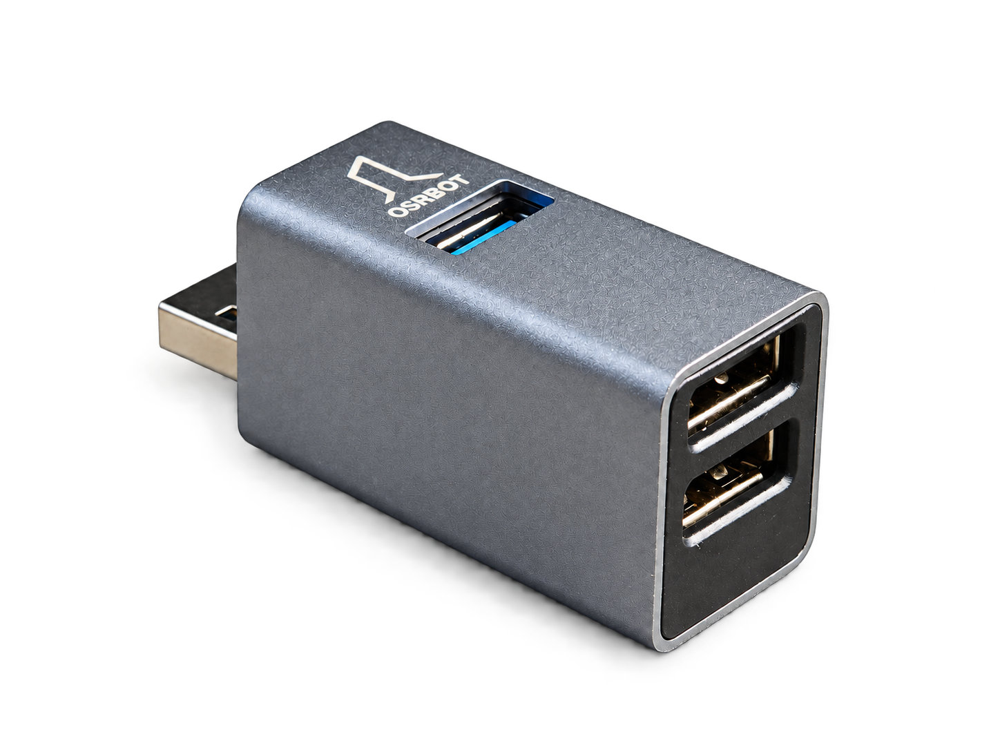
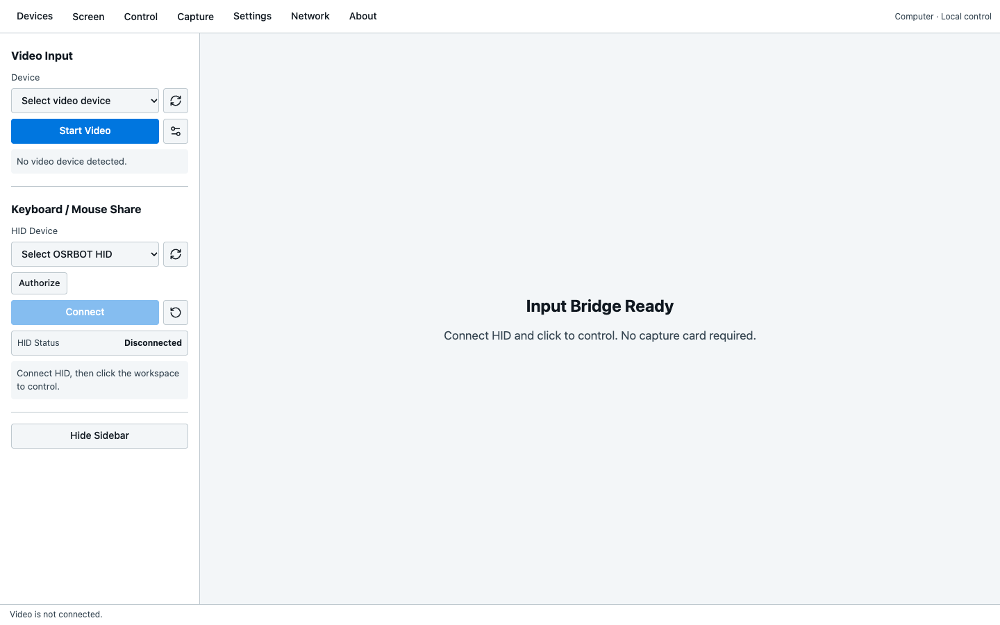
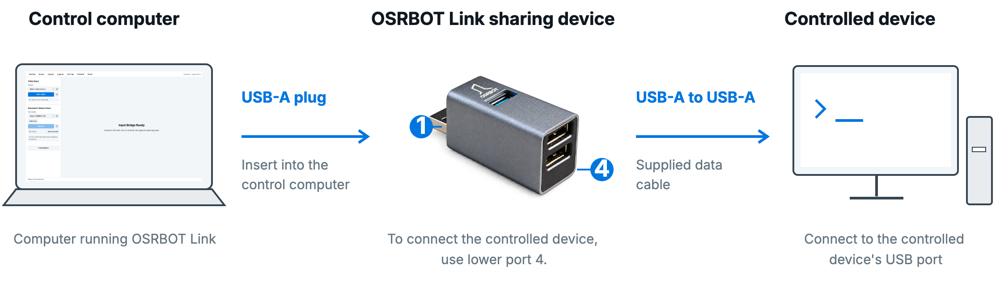

# OSRBOT Link Keyboard and Mouse Sharing Device

[简体中文](README_CN.md) · **[Download](https://github.com/osrbot/osrbot-link/releases)** · [Product manual](docs/manual/OSRBOT_Link_Product_Manual_EN_v1.0.pdf)

Use your computer's keyboard and mouse to operate another device for robot debugging, industrial maintenance or teaching. The control computer runs **OSRBOT Link** and sends input over USB. **No companion software is required on the controlled device**, which must accept USB keyboard and mouse input.

## Core capabilities

- **Keyboard and mouse control:** Direct USB input, with absolute positioning for computers and relative mouse mode for compatible Android devices.
- **Video and recording:** Add a capture card to view the screen, adjust scaling or fullscreen, and save screenshots, recordings and GIFs.
- **Input and maintenance:** ASCII command pasting, language and appearance preferences, shortcut settings, HID recovery and local diagnostic logs.
- **Networking and collaboration:** Share the control computer's network over Ethernet, or let other computers on a trusted LAN view or control through a browser.

*OSRBOT Link English interface example, with no device connected.*

## Connections

Connect both devices over USB using the **included USB-A to USB-A data cable**. Add a capture card for video; network sharing uses a separate Ethernet connection. The three paths are independent.

Video specifications depend on the selected capture card. The USB input path has very low latency; visual feedback delay mainly comes from capture, processing and display. LAN access also depends on network conditions.

## Download

**[Download OSRBOT Link from GitHub Releases](https://github.com/osrbot/osrbot-link/releases)**

Choose the package for the control computer's system and processor. See the selected release for requirements and installation notes.

| Control computer | Package |
| --- | --- |
| Windows x64 | Portable EXE / installer EXE |
| macOS | Apple Silicon / Intel DMG |
| Ubuntu x86_64 | DEB / AppImage for 22.04, 24.04 and 26.04 |

See the [English product manual](docs/manual/OSRBOT_Link_Product_Manual_EN_v1.0.pdf) for complete port, wiring and software instructions.

## Purchase and support

The sharing device, capture card and bundle are available separately. You can also choose your own capture card. For selection, accessories or help, [contact OSRBOT](mailto:winter@osrbot.com).

[OSRBOT](https://www.osrbot.com) · [winter@osrbot.com](mailto:winter@osrbot.com)
