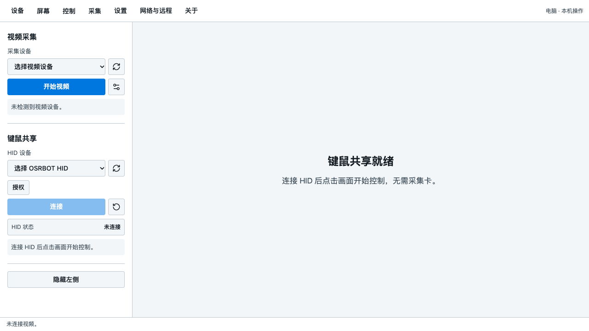
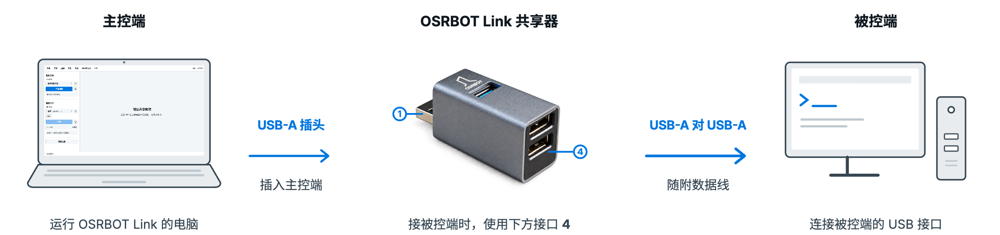

# OSRBOT Link 键盘鼠标共享器

[English](README.md) · **[软件下载](https://github.com/osrbot/osrbot-link/releases)** · [产品手册](docs/manual/OSRBOT_Link_Product_Manual_CN_v1.0.pdf)

使用主控端的键盘和鼠标，通过 USB 操作另一台设备，适合机器人调试、工控机维护和教学演示。主控端运行 **OSRBOT Link**；**被控端无需安装配套软件**，须支持 USB 键盘和鼠标输入。

## 核心能力

- **键鼠控制**：USB 直连，支持电脑绝对定位与兼容安卓设备的相对鼠标模式。
- **画面与记录**：搭配采集卡查看画面，调整缩放或全屏，保存截图、录屏和 GIF。
- **输入与维护**：英文命令粘贴助手、语言与外观偏好、快捷键设置，以及 HID 恢复和本地诊断日志。
- **网络与协作**：通过以太网共享主控端的网络；也可让可信局域网内的其他电脑通过浏览器查看或控制。

*OSRBOT Link 中文界面示意，当前未连接设备。*

## 连接方式

共享器通过 USB 连接两端，**随附 USB-A 对 USB-A 数据线**。需要画面时另接采集卡；网络共享单独使用以太网，三条链路互相独立。

视频规格由所选采集卡决定。USB 键鼠输入链路延迟极低；画面反馈延迟主要来自采集、处理与显示，局域网访问还受网络条件影响。

## 软件下载

**[前往 GitHub Releases 下载 OSRBOT Link](https://github.com/osrbot/osrbot-link/releases)**

按主控端系统与处理器选择软件包，系统要求和安装提醒见对应发布说明。

| 主控端 | 软件包 |
| --- | --- |
| Windows x64 | 便携版 EXE / 安装版 EXE |
| macOS | Apple Silicon / Intel DMG |
| Ubuntu x86_64 | DEB / AppImage，适用于 22.04、24.04、26.04 |

完整的接口、接线和软件操作说明见 [中文产品手册](docs/manual/OSRBOT_Link_Product_Manual_CN_v1.0.pdf)。

## 选购与支持

共享器、采集卡及两者套餐均可选购，采集卡也可自行购买。设备选型、配套与使用问题请[联系 OSRBOT](mailto:winter@osrbot.com)。

[OSRBOT](https://www.osrbot.com) · [winter@osrbot.com](mailto:winter@osrbot.com)
